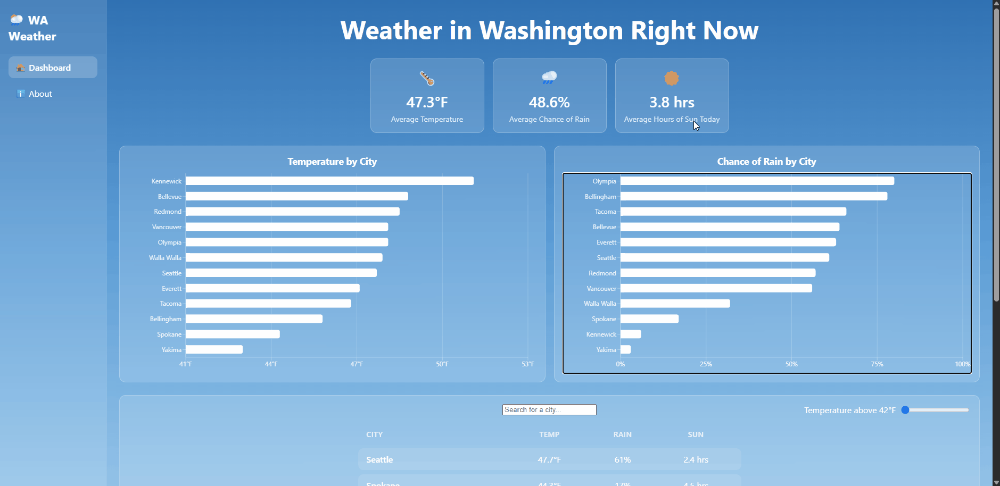

# Web Development Project 6 - *Weather in Washington Right Now*

Submitted by: **Reagan George**

This web app: **Shows you the current weather in Washington right now across twelve different cities. You can search for a city or filter by temperature, and the averages and charts update to match your list. Click on any city to get a page with more details about its weather today, like feels like temp, humidity, wind, UV index, and sunrise/sunset.**

Time spent: **4** hours spent in total

## Required Features

The following **required** functionality is completed:

- [x] **Clicking on an item in the list view displays more details about it**
  - Clicking on an item in the dashboard list navigates to a detail view for that item
  - Detail view includes extra information about the item not included in the dashboard view
  - The same sidebar is displayed in detail view as in dashboard view
  - *To ensure an accurate grade, your sidebar **must** be viewable when showing the details view in your recording.*
- [x] **Each detail view of an item has a direct, unique URL link to that item’s detail view page**
  -  *To ensure an accurate grade, the URL/address bar of your web browser **must** be viewable in your recording.*
- [x] **The app includes at least two unique charts developed using the fetched data that tell an interesting story**
  - At least two charts should be incorporated into the dashboard view of the site
  - Each chart should describe a different aspect of the dataset
    - Temperature by city
    - Chance of rain by city

The following **optional** features are implemented:

- [ ] The site’s customized dashboard contains more content that explains what is interesting about the data 
  - e.g., an additional description, graph annotation, suggestion for which filters to use, or an additional page that explains more about the data
- [ ] The site allows users to toggle between different data visualizations
  - User should be able to use some mechanism to toggle between displaying and hiding visualizations 

  
The following **additional** features are implemented:

* [x] The charts use the same filters as the list, so if you search or move the slider the charts update too
* [x] Each city page shows which side of the Cascades it's on and does its own fetch, so the link still works if you open it directly
* [x] If you go to a city that doesn't exist it shows a "City not found" page instead of breaking
* [x] Added an About page to the sidebar
* [x] The temperature slider's min and max come from the lowest and highest temperatures in the data
* [x] The temperature slider has a short delay so the list only updates once you stop sliding

## Video Walkthrough

Here's a walkthrough of implemented user stories:

GIF created with n-studio

## Notes

No major challenges with this part.

## Part 1 (Project 5)

The original dashboard with the summary cards, search bar, and temperature slider was built in part 1. Here's the walkthrough for that:

## License

    Copyright 2026 Reagan George

    Licensed under the Apache License, Version 2.0 (the "License");
    you may not use this file except in compliance with the License.
    You may obtain a copy of the License at

        http://www.apache.org/licenses/LICENSE-2.0

    Unless required by applicable law or agreed to in writing, software
    distributed under the License is distributed on an "AS IS" BASIS,
    WITHOUT WARRANTIES OR CONDITIONS OF ANY KIND, either express or implied.
    See the License for the specific language governing permissions and
    limitations under the License.
